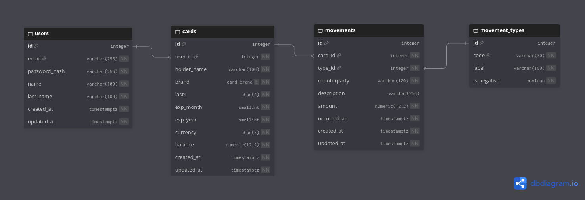

# GranaBank

## Descripción

## Demo

## Cómo correrlo

Requisitos: Node.js 22 y una base PostgreSQL (por ejemplo, una branch de [Neon](https://neon.tech)).

### API

```bash
cd api
npm install
cp .env.example .env   # completar DATABASE_URL, DATABASE_URL_DIRECT y JWT_SECRET
npm run db:migrate     # crea las tablas
npm run db:seed:all    # carga los datos de prueba
npm run dev            # http://localhost:3001/health
```

Para revertir: `npm run db:seed:undo:all` (datos) y `npm run db:migrate:undo:all` (tablas).

Para probar los endpoints: `api/requests.http` (extensión REST Client de VS Code) y `npm test` (tests de integración con vitest + supertest; usan la base del `.env`).

### Web

Con la API corriendo, en otra terminal:

```bash
cd web
npm install
cp .env.example .env.local   # API_URL=http://localhost:3001
npm run dev                  # http://localhost:3000
```

Credenciales: `soygranate@clublanus.com` / `GRANATE1@`.

### Deploy

Dos proyectos de Vercel conectados a este repo, con Root Directory `api` y `web`, y funciones en São Paulo (`gru1`, ver `vercel.json`), igual que la base de Neon.

- API: variables `DATABASE_URL` (pooled de la branch de producción) y `JWT_SECRET`.
- Web: variable `API_URL` (URL de la API, sin barra final).
- Base de producción: `DATABASE_URL_DIRECT='<url directa>' npm run db:migrate && npm run db:seed:all` desde `api/` (la variable del entorno tiene prioridad sobre el `.env`).

## Arquitectura



## Endpoints

Todas las rutas, salvo `/health` y `/auth/login`, requieren `Authorization: Bearer <token>`. Los errores tienen siempre la forma `{ "error": { "code": "...", "message": "..." } }`.

| Método | Ruta | Descripción |
|---|---|---|
| GET | `/health` | Estado de la API. |
| POST | `/auth/login` | Body `{ email, password }` → `{ token, user }`. `400` body inválido, `401` credenciales incorrectas. |
| GET | `/me` | Usuario y sus tarjetas con saldo. |
| GET | `/movements` | Movimientos del usuario, del más reciente al más antiguo. Query: `q` (busca en la contraparte), `type` (`SUBSCRIPTION`, `CASH_IN`, `CASH_OUT`), `limit` (1 a 50, default 20), `offset`. → `{ items, total }`. |
| GET | `/movements/:id` | Detalle de un movimiento con descripción y tarjeta. `404` si no existe o si es de otro usuario. |

Los montos viajan como string (`"125.00"`) para no perder precisión y las fechas en ISO 8601.

## Decisiones técnicas

Ver [docs/DECISIONS.md](docs/DECISIONS.md).

## Mejoras futuras

- Paginación o scroll infinito en Movimientos (hoy se muestran los 50 más recientes).
